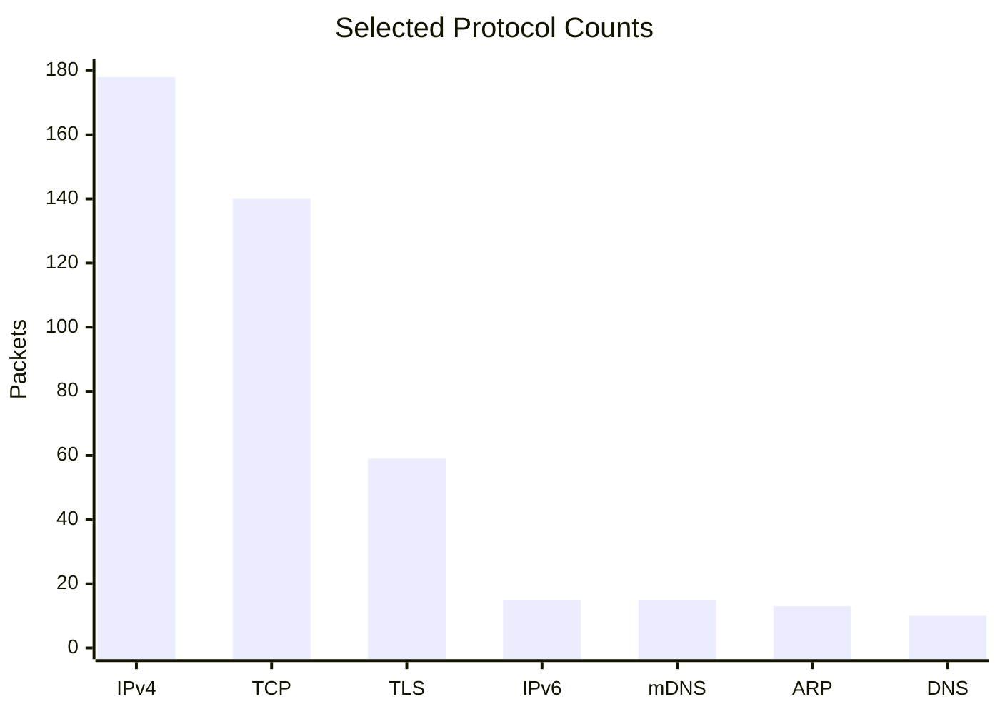
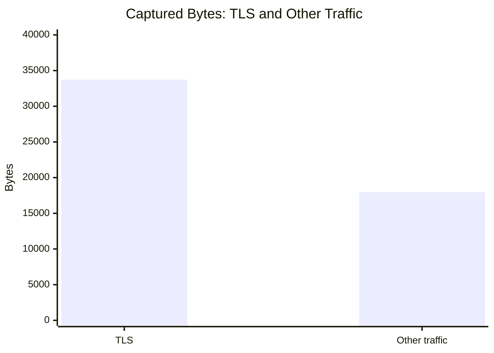

# Beginner Wireshark Network Traffic Investigation

## Project Overview

This project documents a beginner-level network traffic investigation using Wireshark. The purpose was to learn how to inspect captured packets, identify common network protocols, investigate DNS activity, and record evidence-based findings.

**Tools used:** Wireshark 4.6.9  
**Operating system:** Windows 11  
**Capture format:** PCAPNG  
**Investigation level:** Beginner

## Objectives

- Understand basic packet-capture information.
- Identify common network protocols.
- Examine DNS queries and responses.
- Interpret an NXDOMAIN response.
- Review TCP and TLS traffic.
- Create simple graphs to communicate findings.
- Practise writing conclusions without making unsupported claims.

## Capture Overview

| Metric | Observation |
|---|---:|
| Total packets | 221 |
| Total captured bytes | 51,699 |
| Capture duration | Approximately 18.136 seconds |
| IPv4 packets | 178 |
| IPv6 packets | 15 |
| TCP packets | 140 |
| TLS packets | 59 |
| DNS packets | 10 |
| mDNS packets | 15 |
| ARP packets | 13 |
| DHCP packets | 2 |
| SSDP packets | 1 |

*Note: Protocol counts come from Wireshark's Protocol Hierarchy. Counts overlap because a packet can belong to multiple protocol layers. They must not be added together as if they were separate packets.*

## Graph 1: Selected Protocol Counts

The following graph compares selected protocol counts from the capture.

**Interpretation:** IPv4 and TCP were prominent in the capture. TLS also appeared frequently. These counts describe observed network activity; they do not independently indicate whether the traffic was malicious.

## Graph 2: Captured Bytes

Wireshark attributed 33,726 bytes to TLS out of 51,699 total captured bytes.

## Investigation Screenshots

The following screenshots provide visual evidence of the Wireshark analysis performed during this project.

### Screenshot 1: Protocol Hierarchy

This screenshot shows the protocols identified in the network capture and their packet counts.

### Screenshot 2: Selected Protocol Counts

This graph compares selected protocol counts from the capture, including IPv4, TCP, TLS, IPv6, mDNS, ARP and DNS. Protocol counts overlap across layers and should not be interpreted as parts of one total.

### Screenshot 3: DNS Investigation

This screenshot shows the DNS queries for `wpad.lan` and the responses reporting that the requested name was not found (`NXDOMAIN`). This observation alone does not establish malicious activity.

### Screenshot 4: TCP/TLS Traffic

This screenshot shows an example of the TCP/TLS traffic examined during the investigation. Port 443 is commonly used for HTTPS/TLS, but the port number alone does not establish whether traffic is malicious.

**Interpretation:** TLS accounted for approximately 65.2% of the captured bytes, while the remaining traffic accounted for approximately 34.8%. TLS encryption generally prevents the application content from being read directly from ordinary packet details.

## DNS Finding: wpad.lan

During the investigation, two DNS queries for `wpad.lan` were observed. The responses included `No such name`, also known as `NXDOMAIN`.

### What this means

DNS helps devices find IP addresses associated with names. An NXDOMAIN response means the DNS server reported that the requested name did not exist.

WPAD is commonly associated with Web Proxy Auto-Discovery. A device may attempt to resolve a WPAD name while looking for proxy settings.

### Finding

The observed DNS requests for `wpad.lan` failed to resolve according to the DNS responses.

### Security interpretation

This observation may be consistent with routine network or proxy-discovery behaviour. The packets alone do not prove that a proxy was configured, that the device was compromised, or that an attack occurred.

## TCP/TLS Observation

A TCP conversation was observed between a local endpoint using port `7276` and a remote endpoint using port `443`.

Port 443 is commonly used for HTTPS/TLS connections. However, a port number alone cannot establish the identity of the remote service or whether the connection is malicious.

Directional byte figures were excluded because the exact column headings and units were not confirmed during the investigation.

## Conclusion

The approximately 18-second capture contained several common network protocols, including IPv4, TCP, TLS, DNS, mDNS and ARP.

The two `wpad.lan` DNS queries received responses indicating that the requested name did not exist. This is a useful observation to document, but it is not evidence of an attack by itself.

**Overall conclusion:** No confirmed security incident can be established from the evidence reviewed in this beginner investigation.

## Skills Practised

- Navigating Wireshark.
- Using display filters.
- Reading packet-list fields.
- Identifying DNS queries and responses.
- Understanding NXDOMAIN.
- Reviewing protocol statistics.
- Creating basic data visualisations.
- Distinguishing observations from assumptions.

## Limitations and Future Improvements

- The capture lasted only about 18 seconds.
- Encrypted TLS application content was not investigated.
- The analysis did not establish whether any activity was malicious.
- Future work could include examining TCP handshakes, checking DNS response patterns, and plotting packet counts over time.

## Privacy

This project uses a network traffic capture collected for beginner cybersecurity learning. Network captures may contain sensitive information, such as IP addresses and details about network activity. Any shared data should be reviewed to avoid exposing personal or confidential information.

## Disclaimer

This project is for educational purposes only. The investigation focuses on understanding network traffic using Wireshark. The observations do not establish that malicious activity occurred, and no confirmed security incident was identified from the evidence reviewed.
